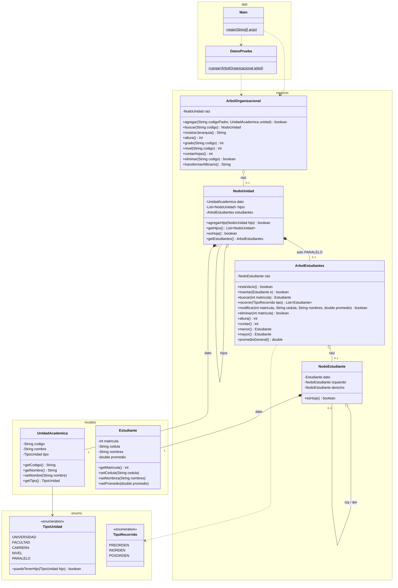

# Diagrama de clases

## Completo

## Relaciones clave

| Relación | Significado |
|---|---|
| `NodoUnidad` → `NodoUnidad` **0..\*** | Un nodo del organigrama tiene cero o muchos hijos: **árbol general** |
| `NodoEstudiante` → `NodoEstudiante` **0..2** | Un nodo del ABB tiene como máximo izquierdo y derecho: **binario** |
| `NodoUnidad` → `ArbolEstudiantes` **0..1** | **Aquí se unen los dos árboles**: solo un PARALELO tiene ABB |
| Nodo ◆ Dato | El nodo contiene al dato (composición) y le agrega los enlaces |
| Árbol ◇ raíz | El árbol solo guarda la raíz; lo demás se alcanza siguiendo enlaces |

## Qué está hecho y qué falta

| Clase | Estado |
|---|---|
| `enums.TipoUnidad`, `enums.TipoRecorrido` | Completos |
| `modelo.UnidadAcademica`, `modelo.Estudiante` | Completas |
| `NodoUnidad`, `NodoEstudiante` | Completas |
| `ArbolOrganizacional`, `ArbolEstudiantes` | Firmas listas, lógica de las Fases 2 y 3 |
| `Main`, `DatosPrueba` | Completas |
