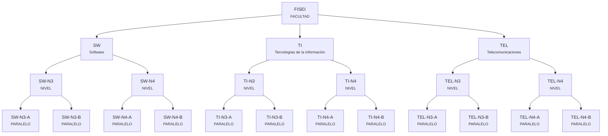
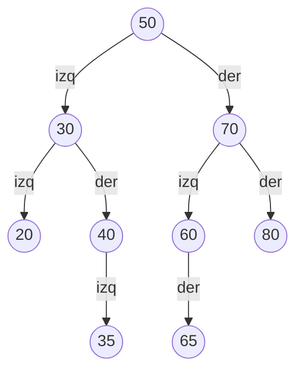
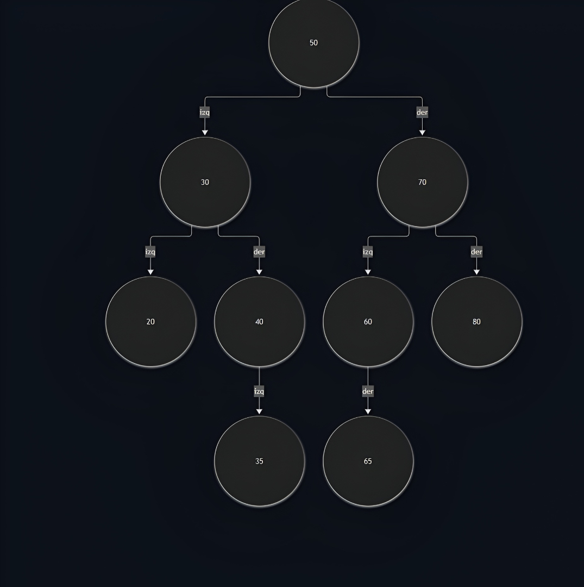

# Ejemplo resuelto: FISEI

Así debe quedar el trabajo de cada equipo (con su propia facultad y sus propias matrículas).

## Árbol general

| Concepto | Respuesta |
|---|---|
| Raíz del subárbol | FISEI |
| Hojas | TI, TEL, AR, IND, SW-N3-A, SW-N3-B, SW-N4 |
| Altura del subárbol | 3 (en el árbol completo de la UTA, FISEI está en nivel 1 y la altura total es 4) |
| Grado de SW | 2 |
| Nivel de SW-N3-B (dentro del subárbol) | 3 |

## ABB del paralelo SW-N3-B

Orden: `50, 30, 70, 20, 40, 60, 80, 35, 65`

| Concepto | Respuesta |
|---|---|
| Raíz | 50 |
| Hojas | 20, 35, 65, 80 |
| Altura | 3 |
| Nivel del 35 | 3 |
